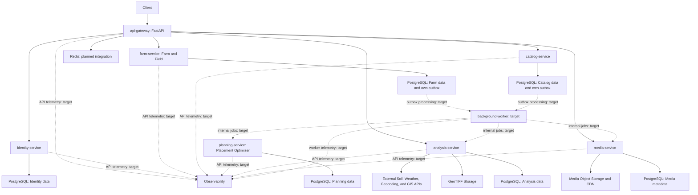

# Architecture

[Index](README.md) · [Roadmap](roadmap.md) · [Service boundaries](decisions/0001-service-boundaries.md)

## Verified current state

| Component | Actually present |
| --- | --- |
| `services/api-gateway` | FastAPI, versioned HTTP routes, bearer authentication through Identity, module/guest access control, and a Farm gRPC client. Only Identity and Farm are connected as domain clients. |
| `services/identity-service` | gRPC for registration, login, guest identities, profile/token validation, refresh rotation/logout, profile updates, password changes, and self-deletion; PostgreSQL users and hashed refresh sessions. See [Identity lifecycle](../services/identity-service/README.md). |
| `services/farm-service` | Owner-scoped farm CRUD over gRPC; a `farms` table with JSONB data. Fields currently reside within farm data; no independent Field persistence or membership implementation has been established. |
| `services/catalog-service`, `planning-service`, `analysis-service`, `media-service` | Directory structure; Compose starts the shared gRPC health process for each, not a domain implementation. |
| `services/background-worker` | Prepared directories, no worker code or Compose service. |
| `packages/api-contracts` | Versioned Protobuf contracts for Identity and Farm. |
| `packages/observability` | Prepared source directory, no shared instrumentation. |
| Infrastructure | PostgreSQL/PostGIS 16/3.4 and Redis 7 in Compose. Identity and Farm use the same database and credentials. Redis is running but is not integrated into the reviewed domain paths. |

[Compose](../infra/compose.yaml) runs Identity and Farm migrations as one-off tasks. By default, the gateway publishes port `8000`, PostgreSQL `5433`, and Redis `6380`, all bound to loopback. Internal gRPC services use port `50051` without host publication. Connections currently use unencrypted internal gRPC; production hardening has not been demonstrated.

The [Farm migration](../services/farm-service/migrations/001_create_farms.sql) contains only the farm table and index. [Farm writes](../services/farm-service/src/farmplan_farm/main.py) do not write to an outbox. There is no Catalog outbox, outbox processing, or implemented external analysis, GeoTIFF, object-storage, or CDN adapter. Gateway module enablement is not evidence of these capabilities.

Auth, user, and module responses now use camelCase and explicit response models. Gateway errors use a shared envelope; refresh credentials use an HttpOnly cookie. See [Gateway compatibility and security policy](../services/api-gateway/README.md). Farm HTTP now exposes typed direct resources, pagination, individual GET, PATCH, and DELETE 204. A development-only JSON seed adapter is available; PostgreSQL remains the default. Polygon boundaries, independent Fields, Planning counts, and cross-service deletion are still unavailable; see the [Farm service limitations](../services/farm-service/README.md). Optional user settings and cross-service account-deletion cleanup remain unimplemented. These implementations have unit/mock coverage, not verified live PostgreSQL/gRPC integration.

## Target architecture – not yet fully implemented

The following diagram is a **target design**, not a depiction of fully operational integrations. In particular, all outbox/worker paths and domain paths for Analysis, Planning, and storage are goals. PostgreSQL nodes represent logical service ownership, not a decision to use separate physical servers.

## Target rules for data and processing

- The gateway remains the public HTTP boundary; domain logic and data ownership belong to the responsible services. Internal interfaces are versioned in `packages/api-contracts`.
- Farm and Catalog store a relevant domain change and its outbox entry **in the same local PostgreSQL transaction**. A failed commit must leave neither a partial domain change nor an orphaned job.
- The worker is intended to process service-owned outboxes and delegate domain work to Planning, Analysis, or Media. Delivery mechanisms, access permissions, and acknowledgment remain undecided; this does not permit general access to other services' domain tables.
- Retries and process termination must be handled: idempotent processing, bounded retries, and visible, actionable permanent failures are goals. No exactly-once guarantee is claimed.
- Planning owns the Placement Optimizer and its rules. Analysis owns external analysis adapters and GeoTIFF processing. Media owns media metadata and object/CDN adapters. The generic worker does not take ownership of these domains.
- PostgreSQL stores service-owned domain data/metadata; GeoTIFFs and media objects have their own storage responsibilities. Redis replaces neither PostgreSQL nor the transactional outbox; its specific role remains open.
- Shared logging, metrics, and tracing hooks belong in `packages/observability`, deployment configuration in `infra/observability`. API requests and asynchronous jobs should be correlatable; secrets and sensitive data must not enter telemetry.

## Intentionally open

The outbox schema, event names/versions, polling versus other delivery mechanisms, need for a broker, retry limits, scheduling, tenant/membership model, Redis usage, physical database separation, storage/CDN providers, external API providers, retention, specific optimization rules, and observability stack are undecided. Contracts and security/operational requirements must be clarified before implementation; see the [roadmap](roadmap.md).
